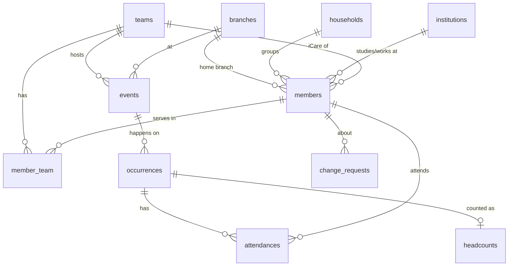

# PRD — IFGF Taipei–Zhongli Member & Attendance System

**Version:** 3.0 · **Date:** 2026-10-04 · **Owner:** Ian Joseph Chandra · **Branch:** `dev`
**Replaces:** PRD 2.5 (2026-08-08) — still readable with `git show feat/postgresql-multisite:PRD.md`.
**Amended:** 2026-10-04 — FR-13 gains the live sheet sync (owner-authorised; D11, D12).

> This file is the scope. Read it whole (hard cap 7,000 tokens). Anything not written here is
> **out of scope** until the owner adds it. Build order and session budgets: `EXECUTION_PLAN.md`.
> Evidence: `GAS_INVENTORY.md`, `WORKBOOK_INVENTORY.md`, the live registration form (read
> 2026-10-04), and `Jemaat & Absensi (4).xlsx` (never committed).

---

## 1. Goal and scope

One Laravel app replaces the Google Form, the Apps Script and the workbook, and adds weekly iCare
attendance.

**Decision 2026-10-04 — clean app.** `dev` becomes a fresh Laravel 13 application that holds only
IFGF code. The GegoSoft ChurchCMS fork is retired from `dev`: none of the features below use it,
and every critical finding of the 2026-09-24 security review sits inside it. The old tree stays
readable on `feat/postgresql-multisite` as a reference.

**In scope (v1)**

1. Registration that matches the Google Form, plus households (FR-1, FR-3)
2. Sign-in by email link and by Google; member self-service (FR-2)
3. School / university search (FR-4)
4. Member category from the workbook formula (FR-5)
5. Birthday → Google Calendar, and birthday tables (FR-6)
6. Sunday attendance by QR scan, short code or roster tick; usher picks the branch (FR-7)
7. Events of any kind — weekly or annual (FR-8)
8. Weekly iCare attendance with guests and back-filled weeks (FR-9)
9. iCare-leader edits confirmed by the member through email (FR-10)
10. Attendance table and category counts (FR-11); quarterly review (FR-12)
11. Imports: the legacy workbook, and LINE recaps (FR-13)
12. Teams: iCare groups and ministry divisions with leaders and members (FR-14)

**Out of scope** — website builder, donations, sermons, discipleship (CGSL) tracking, service
scheduling, NFC tags, photo/face attendance, ticketing, Zoom import, Google Forms ingestion, a
mobile API, Apple sign-in, multi-church, profile photos. Photo and camera attendance, the event
photo finder, analytics, offerings and asset management (Snipe-IT) are future modules, drafted in `ROADMAP.md`; v1 only guarantees the stable keys they
will attach to (`members.public_ref`, `teams.id`). **`ROADMAP.md` is not scope.**

---

## 2. People and permissions

Everyone is a `Member`. There is no separate user table and there are no passwords. What a member
may do comes from team membership — nothing else grants access.

| Who | How | May do |
|---|---|---|
| Member | registers | own profile, QR, attendance history, own household |
| Usher | belongs to a team with `ability = scan` | record attendance at a branch they pick |
| iCare leader | `leader` in an iCare team | FR-9, FR-10, FR-6 table — for that one group only |
| Ministry team leader | `leader` in a ministry team | see that team's roster |
| IT admin | belongs to a team with `ability = admin` | everything: teams, events, imports, reports |

Deny by default. Three Gates carry all authorisation: `scan`, `lead-team` (takes the team),
`admin`. `admin` implies the other two. Only an IT admin changes team membership or roles.
The first IT admin is created by an artisan command, never through a web form.

---

## 3. Functional requirements

### FR-1 Registration — parity with the Google Form

Public form, always open, throttled. Two steps, exactly as the form branches today.

| # | Form label | Column | Req. | Notes |
|---|---|---|---|---|
| 1 | Email | `email` | yes | lower-cased, unique |
| 2 | Full Name (passport / ARC) | `full_name` | yes | |
| 3 | Chinese Name | `chinese_name` | no | |
| 4 | Tanggal Lahir | `birthday` | yes | |
| 5 | Domisili Taiwan | `domicile_taiwan` | yes | free text, e.g. "Taipei - Da'an" |
| 6 | Line ID | `line_id` | no | |
| 7 | WhatsApp Number | `phone` | yes | stored E.164, default region TW |
| 8 | Domisili Gereja IFGF | `branch_id` | yes | Taipei / Zhongli |
| 9 | Plan to attend again? | `status` | yes | **No → `visitor`, form ends here** |
| 10 | Profesi saat ini | `occupation` | yes* | `worker`, `student`, `homemaker`, or typed text |
| 11 | Tingkat Pendidikan | `education_level` | no | `sd smp sma diploma s1 s2 s3` |
| 12 | Sekolah / Kampus / Perusahaan | `school_or_company` | yes* | typeahead, FR-4 |
| 13 | iCare | `icare_team_id` | yes* | active iCare teams, or "Belum mengikuti" = null |

\* only when 9 = Yes. After step 2 the registrant may add family members (FR-3).

On submit: normalise the phone; look for an existing member by **email or phone**.
- Found → change nothing, email that member a sign-in link, show the same success page (no
  "already registered" message — that would reveal who is a member).
- New → create the member, compute the category (FR-5), issue a QR (FR-7), queue the welcome email
  with the QR, queue the birthday event (FR-6), sign the registrant in, show their QR.

*Done when:* the 13 fields, the visitor branch and the duplicate rule are each covered by a test.

### FR-2 Sign-in and member self-service

- **Email link:** enter an email → the answer is always the same → if a member has that email, mail
  a one-time link (15 minutes, single use, only its hash stored).
- **Google:** Socialite; accept only a Google-verified email and match it to `members.email`. No
  match → the registration form with the email filled in.
- Either way sets `email_verified_at`. Sessions in the database, secure cookies.
- Signed in, a member sees their QR, their attendance history, and edits their own profile —
  every FR-1 field except email. A change to name, birthday or iCare re-syncs the calendar (FR-6).

### FR-3 Households

`households` groups members who are family. `members.household_role` is `head`, `spouse`, `child`
or `other`.
- **At registration:** repeatable "add family member" rows — full name, birthday, relationship;
  optional Chinese name, education level, email, phone. They join the registrant's household and
  branch. Each gets their own QR.
- **Afterwards:** an IT admin or iCare leader links existing members into a household; a member
  adds dependants from their profile.
- A family member without an email cannot sign in. Adults of the same household see and present
  that person's QR.

### FR-4 School / university search

`institutions` is a local reference table; registration never calls an outside API.
- Taiwan: `ifgf:institutions:import <csv>` loads the Ministry of Education open data (data.gov.tw
  dataset 27929 — Chinese and English names). Run by hand, at most yearly.
- Indonesia: no official public API exists (PDDikti has only community wrappers). **Later**, and
  only if needed — form field 12 asks for the place of study or work *in Taiwan*.
- The typeahead searches English and Chinese names. A pick stores `institution_id` and the name;
  free text (a company, an unlisted school) stores the name only.

### FR-5 Member category

Stored in `members.category`, recomputed whenever occupation or education changes. First match
wins — this is the workbook's `Kategori` formula, unchanged:

1. education `sd` → **Kids**
2. `student` and education `smp` or `sma` → **Teens and Youth**
3. `student` and education `s1` or `diploma` → **College**
4. otherwise → **Adult**

One addition for family members who have no education level: age under 13 → Kids.

### FR-6 Birthdays

- **Calendar sync (legacy behaviour kept).** One all-day event per member in the church birthday
  calendar, repeating yearly until birth year + 99, reminders at 1 week and 1 day.
  Title `🎂 {full_name} ({chinese_name})'s Birthday`; description: English name, Chinese name,
  year of birth, iCare. The event id lives in `members.calendar_event_id`. A change to birthday,
  name or iCare updates the same event; if that fails, delete and recreate.
  `ifgf:calendar:sync` reconciles everyone. A `CalendarGateway` contract with a fake keeps tests
  offline; the real driver uses a service account kept in `~/.ifgf/`.
- **Birthday table.** Month picker; columns name, iCare, day and month (the year is not shown).
  An iCare leader sees their own group. An IT admin sees the whole church. Nobody else.
- A member maintains their own birthday in their profile.

### FR-7 Sunday attendance

- **QR:** an opaque random token (256 bits), no personal data, replaceable. Only its hash is
  searchable; an encrypted copy lets the member's page redraw it. An 8-character short code is the
  typed fallback. Every QR from the old Google-Form system stops working at cutover.
- **Usher flow:** sign in → pick the branch (remembered for the session) → today's Sunday Service
  for that branch opens (created on first use) → scan → the page shows name, iCare and "recorded"
  or "already recorded".
- **One row per member per occurrence.** Two sessions run each Sunday — Zhongli 10:00–12:00 and
  Taipei 15:00–17:00. A scan belongs to the session the usher's device opened, not to the clock,
  so a volunteer who arrives early is counted in the right one and a second scan changes nothing.
- **Fallbacks:** type the short code (throttled hard — it is guessable), or search the roster and
  tick, with an onsite/online choice.
- Each row keeps who recorded it, when, how (`qr`, `code`, `manual`, `import`) and the member's
  category on that day.
- The usher may pick any other active event for today instead (FR-8).

### FR-8 Events

`events` describes what recurs; `occurrences` is one date of it; `attendances` hang off the
occurrence. Types: `sunday_service`, `icare`, `worship_night`, `class`, `special`. Recurrence:
`weekly`, `annual`, `once`. An occurrence is created the first time someone records attendance
for that date — no scheduled job inserts weeks. Seeded: Sunday Service for each branch, and one
weekly iCare event per iCare team. An IT admin adds the rest (Worship Night, a discipleship class,
Christmas, Passover).

### FR-9 Weekly iCare attendance

For a leader, on their own group:
- The page lists the group's active members; tick who came, save. Re-saving updates the same date.
- **Guest:** add a name for someone not registered yet (kept as `guest_name`).
- **Forgotten weeks:** pick any past date and fill it in the same way.
- Set a member **active** or **inactive** — applied at once, and logged.

### FR-10 Leader-proposed changes

A leader may propose new values for a group member's name, Chinese name, birthday, phone, Line ID,
Taiwan address, occupation, education, school/company, branch and iCare. Never the email.
- Saving creates a `change_requests` row and emails the member the old and new values with
  **Confirm** and **Reject** links (single use, 7 days). A member without an email: the mail goes
  to the head of their household.
- Confirm applies the change, recomputes the category and re-syncs the calendar. Reject or expiry
  changes nothing. The leader sees the state of every request.

### FR-11 Attendance table and counts

- **By date and branch:** who attended, at what time, iCare, category, onsite/online. Above it the
  workbook's totals block: Adult, College, Teens and Youth, Kids, Sub-total.
- **Grid:** members × weeks for a chosen range (default the last 8 weeks), each cell the scan time
  — the `Absen-TPE` / `Absen-ZL` view. CSV export.
- Ushers and IT admins see it; an iCare leader sees their own group's rows.

### FR-12 Quarterly review

Per branch and year, per category plus Sub-total — the workbook's arithmetic, unchanged:
- **weekly** = people recorded onsite that Sunday
- **monthly** = average of that month's weekly figures, **rounded up**
- **quarterly** = average of the three monthly figures, **rounded down**

Two sources, shown side by side: scanned attendance, and the manual **headcount** — the usher's
count by category, including people who are not registered; it is what the 2022–2026 year sheets
hold. Ushers and IT admins enter one headcount per occurrence. Weeks with no data count as zero
(as the sheet does) and the table says how many such weeks there were.

### FR-13 Imports

All three are dry-run first, repeatable without duplicates, and leave an `import_batches` row.
- **Legacy workbook** — `ifgf:import:workbook <path> [--commit]`. Members from `Daftar Jemaat`
  (with the legacy Birthday ID as `calendar_event_id`); attendance from `Daftar Absensi`, where the
  branch comes from the scan time (**before 13:00 = Zhongli, after = Taipei** — the sheet's own
  rule) and `Online = Ya` means online; headcounts from the ten year sheets. Rows that cannot be
  resolved are listed, not guessed.
- **LINE recap** — a CSV upload by an iCare leader or IT admin. Columns `date, icare, name` for
  iCare attendance and `date, branch, adult, college, teens_youth, kids, online, total, reporter`
  for a Sunday headcount. Names are matched inside the group first, then church-wide; an unmatched
  name is shown for the uploader to map to a member or keep as a guest.
  `docs/LINE_IMPORT_PROMPT.md` is the prompt an AI chat uses to turn pasted LINE messages into
  that CSV.
- **Live sheet sync** *(added 2026-10-04)* — `ifgf:import:sheet [--commit]`. Until cutover some
  people keep using the old Google Form and QR, so the app pulls what it is missing from the live
  spreadsheet. The command downloads the spreadsheet as an .xlsx through the Google API —
  read-only, into a temporary file outside the repository — runs the **same** workbook importer
  on it, and deletes the file.
  - **Adds only:** members registered through the old form, scans in `Daftar Absensi`, headcount
    rows. A member is matched by email or normalised phone, a scan by member and occurrence, a
    headcount by occurrence. Where the app already has the record **the app wins**: nothing is
    changed, and the difference is listed in the batch summary.
  - A scan's branch and mode follow the workbook rule above (13:00; `Online = Ya`).
  - A member who arrives this way gets a QR, and their legacy Birthday ID becomes
    `calendar_event_id` — a second calendar event is never created for them. No welcome email
    before cutover (D11).
  - **Schedule:** hourly, behind a config flag that is off by default; production only (D12);
    switched off for good at cutover. A scheduled run refuses to start while the flag is off.
  - **Access and privacy:** a Google service account with Viewer access to that one spreadsheet
    and nothing else; its key and the spreadsheet id live in `~/.ifgf/`. A `SheetGateway`
    contract with a fake keeps tests offline. The `URLs Absensi` sheet is never read. Log lines
    and the batch summary carry row references and field names only — no personal data.

### FR-14 Teams

`teams` holds both iCare groups (`type = icare`) and ministry divisions (`type = ministry`):
Usher, IT, Praise and Worship, Multimedia, Sound, Publication, Documentation, and whatever the IT
admin adds. `member_team` records who is in a team and whether as `leader` or `member`; a team may
have several leaders. Every member additionally has at most one iCare (`members.icare_team_id`).
IT admins maintain rosters and roles. Leaving a team sets `left_at`; the row is kept, so who
served where, and when, stays answerable (`ROADMAP.md` M6).

---

## 4. Data model — 12 tables



```
branches        id, code (TPE|ZL), name, name_zh, gmaps_url, is_active
teams           id, type (icare|ministry), name, branch_id?, meeting_weekday?, ability? (scan|admin),
                is_active
member_team     id, member_id, team_id, role (leader|member), left_at?
                unique(member_id, team_id) among rows where left_at is null
households      id, name
institutions    id, country, code?, name_en, name_zh?               unique(country, code)
members         id, public_ref (uuid), household_id?, household_role?, branch_id, icare_team_id?,
                institution_id?, full_name, chinese_name?, email? (unique), phone?, line_id?,
                birthday?, domicile_taiwan?, occupation?, education_level?, school_or_company?,
                category, status (active|inactive|visitor),
                qr_token_hash? (unique), qr_token_enc?, short_code? (unique),
                calendar_event_id?, calendar_synced_at?, email_verified_at?, remember_token,
                legacy_ref?, timestamps, deleted_at
events          id, type, name, branch_id?, team_id?, recurrence, weekday?, is_active
occurrences     id, event_id, occurs_on, locked_at?                  unique(event_id, occurs_on)
attendances     id, occurrence_id, member_id?, guest_name?, mode (onsite|online),
                method (qr|code|manual|import), category?, recorded_by?, recorded_at
                unique(occurrence_id, member_id)
headcounts      id, occurrence_id (unique), adult, college, teens_youth, kids, online, total,
                reporter?, source (manual|line|import)
change_requests id, member_id, requested_by, changes (jsonb), token_hash, status, expires_at,
                decided_at?
import_batches  id, source, file_hash, mode, status, summary (jsonb), created_by?
```

Plus the framework's own `sessions`, `cache` and `jobs`. All tables have `timestamps`.

**Why this is the minimum.** v2 had 13 `ifgf_` tables beside 93 upstream ones. Folded in:
- `contact_points` → three columns on `members` (a member has one email, one phone, one Line ID)
- `member_credentials` → three columns (one live QR per member; replacing it overwrites)
- `calendar_links` → two columns (there is one calendar)
- `member_categories` → a PHP enum (four fixed values defined by a formula)
- `group_memberships` → `members.icare_team_id` (attendance already records history)
- `icare_groups` + roles → `teams` + `member_team` (an iCare group and a ministry team are the
  same shape: a name, leaders, members)
- `service_occurrences` → `events` + `occurrences` (so non-Sunday events need no schema change)
- `import_conflicts` → `import_batches.summary`; `form_ingestions`, `is_demo` → dropped

Values with a fixed list (`category`, `status`, `mode`, `method`, team `type`, …) are short string
columns backed by PHP enums — no database enums, no lookup tables.

---

## 5. Security and privacy baseline

Member data is personal data under Taiwan's PDPA. These are requirements, each with a test.
How they are tested, and the rules for databases and environments, are in `STANDARDS.md`.

1. Every route needs a signed-in member except: registration, sign-in, the Google callback, and
   the confirm/reject links. No `routes/api.php` in v1.
2. No route creates an IT admin. No sequential id in any URL or QR — `public_ref` only.
3. A member page shows only the signed-in member and their household. No `?member=` links.
4. Blade output is escaped (`{{ }}`); `{!! !!}` is banned outside generated QR SVG.
5. Throttles on registration, sign-in link, scan and — hardest — short code.
6. Behind Cloudflare: trusted proxies set, HTTPS forced, secure same-site cookies, the visitor IP
   read from Cloudflare's header so throttles are per visitor.
7. `APP_DEBUG=false` in production; no debug bar, no installer, no API docs page.
8. PostgreSQL listens on localhost only; the app's role owns one database and is not a superuser.
9. Secrets live outside the repo (`~/.ifgf/`). No member data, workbook or credential is ever
   committed.
10. The registration form states what is collected and why; lists show the least needed (no birth
    year, no contact details in rosters unless the viewer leads that group).
11. Test, development, staging and production each have their own database and role; production
    data is never copied to another environment; destructive commands cannot run in production.
12. Security headers on every response (HSTS, no-sniff, frame, referrer and content policies).
13. Role and team changes, imports and deletions are written to an audit log.
14. An IT admin can delete a member on request: the row is anonymised, the QR and the calendar
    event are removed, attendance counts stay.

---

## 6. Technology

Laravel 13 · PHP 8.4 · PostgreSQL 17 (Eloquent, `pdo_pgsql`) · Blade + Tailwind + Alpine through
Vite · no SPA. Packages beyond the skeleton: `laravel/socialite`, `simplesoftwareio/simple-qrcode`,
`phpoffice/phpspreadsheet` (import only), a Google API client (FR-6 and the live sheet sync only).
Languages `id` (default), `en`, `zh_TW`. Every screen works on a phone first and on a desktop.
Mail and calendar jobs run on the database queue. Tests at three levels — automated on
PostgreSQL, a local run-through, and a smoke check through Cloudflare — as `STANDARDS.md` sets
out. Deployment target: a self-hosted Ubuntu PC behind a Cloudflare Tunnel, with a staging
hostname beside the production one.

---

## 7. Defaults I assumed — owner may overrule

| # | Default | Why it is a question |
|---|---|---|
| D1 | Headcount by category is kept (FR-12) | It is in the year sheets but was not in the 17 points |
| D2 | Registration is always open | The Apps Script opened the form Saturday, closed it Monday |
| D3 | IT admin also sees the church-wide birthday table | Owner said "only iCare leaders" |
| D4 | One website, areas `/`, `/usher`, `/icare`, `/admin` | v2 planned two hostnames |
| D5 | Quarterly review counts missing weeks as zero | Matches the sheet; lowers the average |
| D6 | Children with no education level and under 13 are Kids | The formula has no such case |
| D7 | No yearly "Goal" column in the quarterly review | It is in the sheet; needs a goals table |
| D8 | Ministry team leaders only view their roster | Could also let them edit it |
| D9 | Indonesian universities are not loaded | No official API; field 12 asks about Taiwan |
| D10 | Each PHP file carries a one-line SPDX licence tag, added by script | v2 typed a 17-line AGPL header into every file |
| D11 | A member pulled in by the live sheet sync gets the welcome email and new QR only at cutover | Mailing now would announce the new system early |
| D12 | The live sheet sync runs in production only | Staging keeps demo data (`STANDARDS.md` §1) |

Needed from the owner before the work package that uses it: a mail provider (WP3), a Google OAuth
client (WP2), SSH access to the Ubuntu PC and a staging hostname on Cloudflare (WP2S), a calendar
service account (WP6), a Viewer-only service account for the spreadsheet and its id (WP7), two or
three real LINE recaps (WP8).
