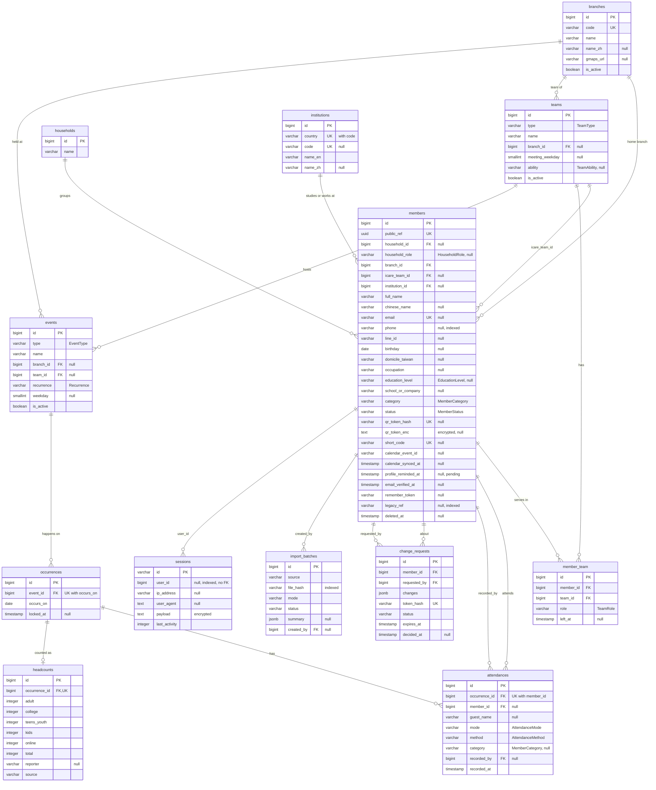
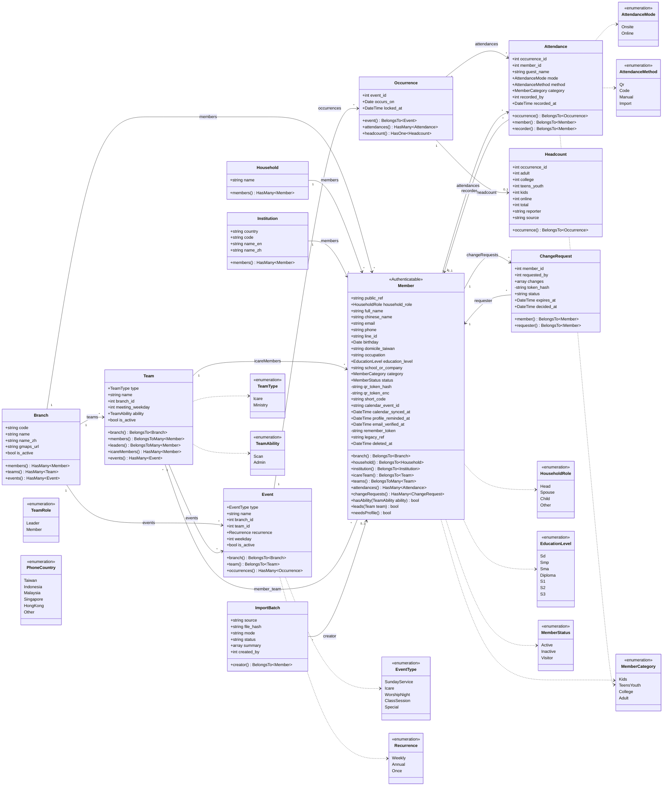
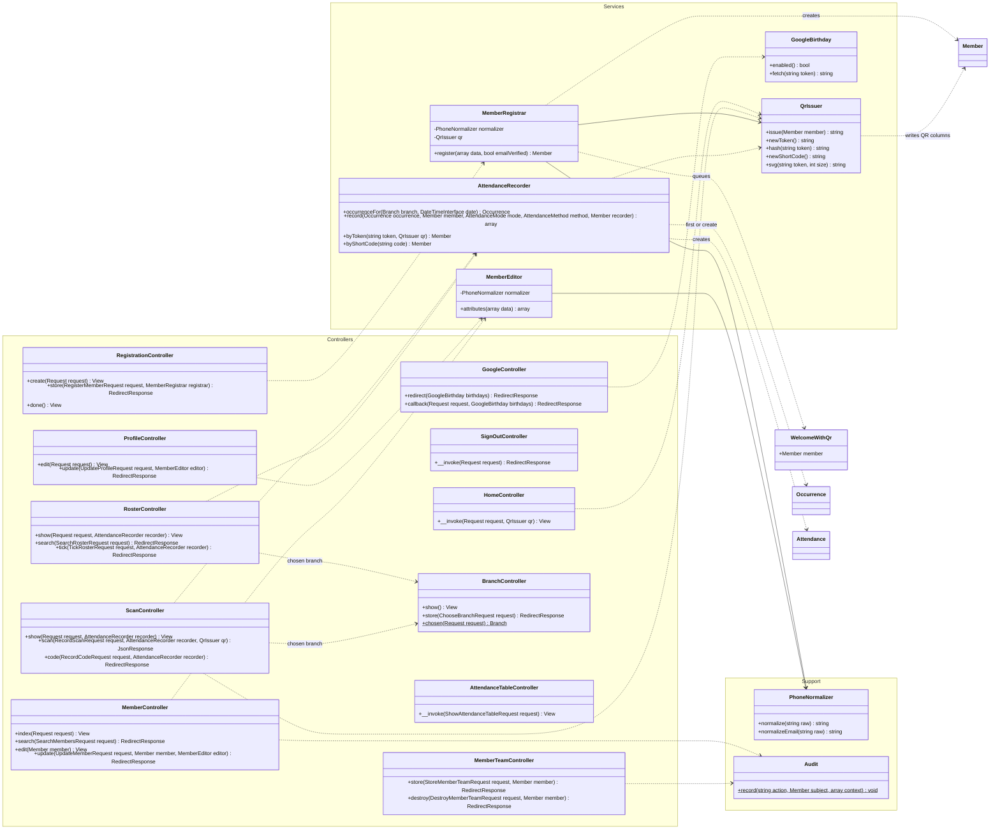
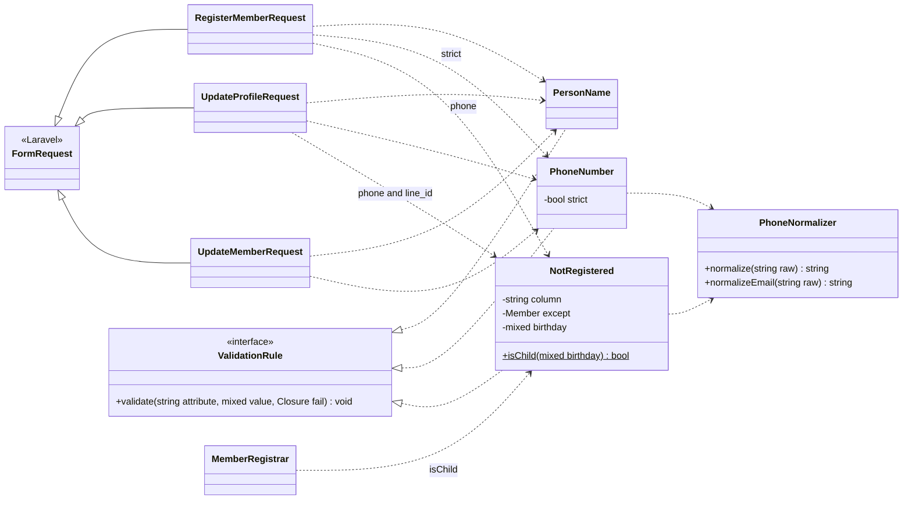
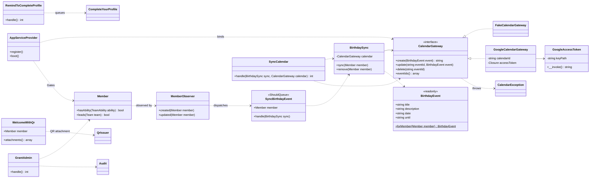

<p align="center"><a href="https://laravel.com" target="_blank"></a></p>

<p align="center">
<a href="https://github.com/laravel/framework/actions"></a>
<a href="https://packagist.org/packages/laravel/framework"></a>
<a href="https://packagist.org/packages/laravel/framework"></a>
<a href="https://packagist.org/packages/laravel/framework"></a>
</p>

## Data model

The app is the IFGF Taipei–Zhongli member and attendance system (`PRD.md` 3.0): Laravel 13,
PHP 8.4, PostgreSQL 17. This section draws it twice, as the database (ERD) and as the code's
classes. The table-by-table inventory, the queries against the indexes, the personal data per
table and the ranked review findings are in [`DATA_MODEL.md`](DATA_MODEL.md).

### Database — entity-relationship diagram

There are 12 domain tables. `sessions` belongs to the framework and is drawn because
`sessions.user_id` points at a member. `cache`, `cache_locks`, `jobs`, `job_batches` and
`failed_jobs` are left out, because no domain table refers to them.

How to read it:
- Types are PostgreSQL types.
- A quoted `null` means the column is nullable.
- A quoted enum name is the PHP enum that backs a string column.
- `created_at` and `updated_at` exist on every table except `sessions` and are omitted.



### Class diagram

#### How the class diagram lines up with the ERD

They share a structure only where the code holds data. Each Eloquent model maps to one table,
and each foreign key becomes a pair of relation methods: `belongsTo` on the class that holds the
key, and `hasMany` or `hasOne` on the other. The cardinalities are the same in both drawings.
Everything else differs, in one of two directions.

**In the database but not a class:**
- `member_team` is a pivot table. In the code it is the `belongsToMany` between `Member` and
  `Team`, and its `role` and `left_at` columns are pivot attributes.
- `sessions`, `cache` and `jobs` have no model.
- Indexes, unique and partial-unique constraints, and ON DELETE rules exist only in the database.

**In the code but not a table:**
- The 12 enums are classes. Each one is stored as a `varchar` on the table that uses it.
  `PhoneCountry` is not stored anywhere: it only picks the expected phone shape on the form.
- Some behaviour has no column: `Member::hasAbility()`, `leads()`, `needsProfile()`, and the
  `category` recomputed on every save.
- Hidden and encrypted attributes exist only in the code.
- `Member extends Authenticatable`; tables have no inheritance.
- Controllers, form requests, rules, services, jobs, mail, observers and commands have no table
  at all. They are the application around the data, drawn in diagrams 2 to 4.

#### 1 · Domain models and enums (mirrors the ERD)



#### 2 · Web requests: controllers and services

The controllers are thin. Each method receives its form request and the service it needs
through Laravel's container, so the signatures below are the dependency list. Every controller
extends `Controller`. Models appear by name only; their detail is in diagram 1. A dotted arrow
means "uses", and a solid arrow is a constructor dependency.



#### 3 · Form requests and validation rules

All 12 form requests extend `FormRequest`. Only the three below use the app's own rules; the
other nine check their input with Laravel's built-in rules.



#### 4 · Background work, the birthday calendar, commands and mail

Whenever a member is created, or their name, Chinese name, birthday or iCare changes,
`MemberObserver` queues `SyncBirthdayEvent` after the transaction commits.
`AppServiceProvider` binds `CalendarGateway` to the fake, or to Google when configured (never in
tests). It also defines the three Gates — `scan`, `lead-team` and `admin` — on top of
`Member::hasAbility()` and `leads()`.

The commands are `ifgf:admin:grant`, `ifgf:calendar:sync` and `ifgf:profile:remind` (daily at
19:00, Asia/Taipei).



## About Laravel

Laravel is a web application framework with expressive, elegant syntax. We believe development must be an enjoyable and creative experience to be truly fulfilling. Laravel takes the pain out of development by easing common tasks used in many web projects, such as:

- [Simple, fast routing engine](https://laravel.com/docs/routing).
- [Powerful dependency injection container](https://laravel.com/docs/container).
- Multiple back-ends for [session](https://laravel.com/docs/session) and [cache](https://laravel.com/docs/cache) storage.
- Expressive, intuitive [database ORM](https://laravel.com/docs/eloquent).
- Database agnostic [schema migrations](https://laravel.com/docs/migrations).
- [Robust background job processing](https://laravel.com/docs/queues).
- [Real-time event broadcasting](https://laravel.com/docs/broadcasting).

Laravel is accessible, powerful, and provides tools required for large, robust applications.

## Learning Laravel

Laravel has the most extensive and thorough [documentation](https://laravel.com/docs) and video tutorial library of all modern web application frameworks, making it a breeze to get started with the framework.

In addition, [Laracasts](https://laracasts.com) contains thousands of video tutorials on a range of topics including Laravel, modern PHP, unit testing, and JavaScript. Boost your skills by digging into our comprehensive video library.

You can also watch bite-sized lessons with real-world projects on [Laravel Learn](https://laravel.com/learn), where you will be guided through building a Laravel application from scratch while learning PHP fundamentals.

## Agentic Development

Laravel's predictable structure and conventions make it ideal for AI coding agents like Claude Code, Cursor, and GitHub Copilot. Install [Laravel Boost](https://laravel.com/docs/ai) to supercharge your AI workflow:

```bash
composer require laravel/boost --dev

php artisan boost:install
```

Boost provides your agent 15+ tools and skills that help agents build Laravel applications while following best practices.

## Contributing

Thank you for considering contributing to the Laravel framework! The contribution guide can be found in the [Laravel documentation](https://laravel.com/docs/contributions).

## Code of Conduct

In order to ensure that the Laravel community is welcoming to all, please review and abide by the [Code of Conduct](https://laravel.com/docs/contributions#code-of-conduct).

## Security Vulnerabilities

If you discover a security vulnerability within Laravel, please send an e-mail to Taylor Otwell via [taylor@laravel.com](mailto:taylor@laravel.com). All security vulnerabilities will be promptly addressed.

## License

The Laravel framework is open-sourced software licensed under the [MIT license](https://opensource.org/licenses/MIT).
